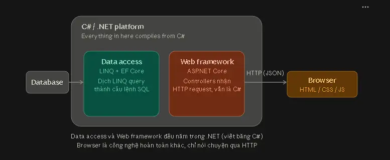

# PBL — Thiết kế hệ thống

Thiết kế phục vụ hệ thống web trung gian cho thuê ô tô. Quy tắc nghiệp vụ thống nhất tại [PBL - Shared Rental Rules](../requirements/shared-rental-rules.md); tài liệu này mô tả cách tổ chức chức năng và dữ liệu.

## 1. Các nhóm chức năng

| Nhóm | Nội dung |
| --- | --- |
| Tài khoản | Đăng ký, đăng nhập, hồ sơ cá nhân, vai trò và quyền truy cập |
| Đăng ký chủ xe | Nộp hồ sơ mô phỏng, xét duyệt, bổ sung quyền chủ xe |
| Tin đăng | Thêm, xem, sửa, ngừng hiển thị tin; ảnh, giá, điểm nhận xe và lịch trống |
| Đơn thuê | Kiểm tra lịch, đặt cọc, chờ duyệt, duyệt hoặc từ chối, hủy và hết hạn |
| Bàn giao | Ảnh và thời điểm xác nhận ở đầu chuyến, cuối chuyến; theo dõi từng bên xác nhận trả xe |
| Thanh toán và doanh thu | Mô phỏng cọc, ghi nhận chủ xe nhận tiền mặt, hoa hồng và doanh thu khi hoàn tất |
| Quản trị | Quản lý người dùng và tin đăng; quản trị viên quản lý cấu hình và tài khoản quản trị |
| Phần mở rộng | Đánh giá, khiếu nại, bản đồ, chatbot, thông báo và báo cáo nâng cao |

## 2. 3-Layer 

**Presentation Layer** (`CarRental.Web`) nhận yêu cầu, hiển thị dữ liệu và kiểm tra quyền truy cập chức năng. **Business Logic Layer** (`CarRental.Services`) kiểm tra quyền sở hữu, trạng thái đơn, lịch trùng và điều kiện chuyển trạng thái. **Data Layer** (`CarRental.Data`) đọc, ghi MySQL qua Entity Framework Core. `CarRental.Models` chứa các class và data type trao đổi.

Việc chỉ ẩn nút trên giao diện không đủ để kiểm soát quyền. Mỗi thao tác phải được kiểm tra phía máy chủ, kể cả khi người dùng gửi trực tiếp mã đơn hoặc mã xe khác.

## 3. Dữ liệu chính

Đây là danh sách phục vụ thiết kế sơ đồ dữ liệu; tên cột chi tiết được thống nhất khi triển khai.

| Nhóm dữ liệu | Nội dung cần lưu |
| --- | --- |
| Tài khoản và quyền | Các bảng Identity; một người dùng có thể có cả `Renter` và `Owner` |
| Hồ sơ chủ xe | Người gửi, tài liệu, trạng thái xét duyệt, người xử lý |
| Xe và tin đăng | Chủ xe, thông tin xe, ảnh, giá, trạng thái tin và tọa độ nhận xe |
| Lịch xe | Khoảng thời gian không nhận thuê và các khoảng đã được đơn thuê giữ |
| Đơn thuê | Xe, người thuê, thời gian, giá được xác nhận, trạng thái, hạn duyệt |
| Thanh toán | Khoản cọc mô phỏng, tiền còn lại, phương thức, kết quả và người xác nhận tiền mặt |
| Bàn giao | Đơn thuê, lần giao hoặc trả, ảnh, thời điểm, người xác nhận và tiến độ từng bên |
| Đánh giá | Đơn, người gửi, người nhận, số sao, nội dung, thời điểm và trạng thái công khai |
| Khiếu nại | Đơn, người gửi, mô tả, bằng chứng, trạng thái xử lý và người xử lý |
| Xử lý vi phạm | Tài khoản hoặc tin bị xử lý, lý do, mức vi phạm, thời hạn và người thực hiện |

Hoa hồng dùng một giá trị cấu hình do quản trị viên quản lý. Không thiết kế bảng ví, số dư rút được hoặc yêu cầu rút tiền.

## 4. Tạo đơn và giữ lịch

Trước khi đặt cọc, kiểm tra xe, thời gian và giá. Khi mô phỏng cọc thành công, việc ghi nhận cọc, tạo đơn `Pending` và giữ lịch phải nhất quán. Nếu hai người đặt cùng lúc, chỉ một người có thể giữ khoảng lịch đó; không hiển thị thành công cho đơn không giữ được lịch.

Khi duyệt, kiểm tra lại chủ xe, thời hạn, trạng thái và lịch hiện hành. Phép kiểm tra phải nhận diện khoảng lịch của chính đơn đang duyệt để không coi đó là đơn khác bị trùng. Khi hết hạn chờ duyệt, cập nhật `Expired` và giải phóng lịch trong cùng lần xử lý.

Tránh xử lý lặp khi người dùng bấm nhiều lần hoặc gửi lại sau mất kết nối. Cách ghi nhận cọc khi hủy, từ chối hoặc hết hạn còn nằm tại [PBL - Review Guide](../requirements/open-decisions.md).

## 5. Trạng thái và bàn giao

Trạng thái đơn đi theo `Pending → Approved → InRental → Returned → Completed`; thanh toán `Paid` được lưu riêng. Ảnh và thời điểm xác nhận là bắt buộc ở cả hai lần bàn giao. Không thiết kế OTP/QR.

Mỗi bên xác nhận trả xe độc lập. Hệ thống lưu người và thời điểm xác nhận; chỉ khi đủ hai bên mới chuyển `Returned`. Khi kiểm tra hoàn tất, đọc cả tình trạng khiếu nại để không ghi doanh thu hoặc mở đánh giá quá sớm.

## 6. Giá và doanh thu

Lưu giá đã xác nhận trong đơn, không lấy giá tin đăng hiện tại để tính lại đơn đã duyệt. Chỉ tổng hợp doanh thu từ đơn `Completed`; hiển thị tổng tiền thuê, hoa hồng và phần của chủ xe. Lần kiểm tra hoàn tất lặp lại không được ghi doanh thu hai lần.

Mức cọc, cách làm tròn và hiệu lực của thay đổi tỷ lệ hoa hồng cần bổ sung trước khi hoàn thiện tính tiền. Không thêm thuế hoặc chức năng rút tiền.

## 7. Quyền và dữ liệu cá nhân

Nhân viên chỉ quản lý tài khoản người thuê, chủ xe và tin đăng. Quản trị viên có thêm quyền cấu hình, báo cáo toàn nền tảng và quản lý nhân viên, quản trị viên khác. Mọi thao tác lên tài khoản quản trị phải kiểm tra quyền quản trị viên thực sự; chỉ có vai trò Identity `Admin` là chưa đủ.

Mật khẩu dùng cơ chế băm của Identity. Dữ liệu nhạy cảm như số điện thoại hoặc CCCD phải được mã hóa nếu thu thập, và chỉ hiển thị cho người có quyền. Không đưa giấy tờ hoặc bằng chứng khiếu nại vào dữ liệu công khai.

## 8. Tích hợp mở rộng

**Bản đồ:** Leaflet.js và OpenStreetMap hiển thị điểm nhận xe từ `Latitude` và `Longitude`. Dịch vụ đổi địa chỉ thành tọa độ chưa được chọn.

**Chatbot:** tái sử dụng dịch vụ Python với LlamaIndex, Gemini và FastAPI từ [ChatbotRAG](https://github.com/shen1705/Chatbot/tree/An). Ứng dụng .NET gọi dịch vụ qua HTTP. Chatbot chỉ tra cứu chính sách tĩnh; luồng đặt thuê vẫn hoạt động khi chatbot gián đoạn.

