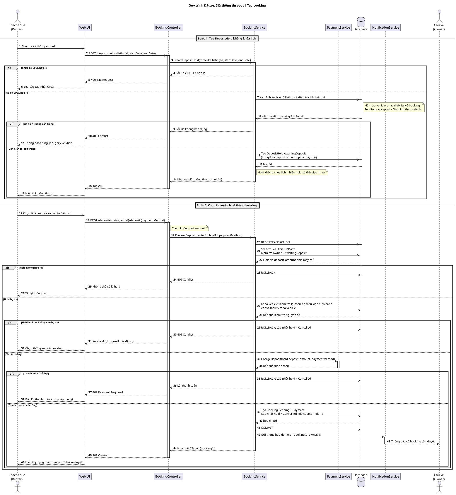
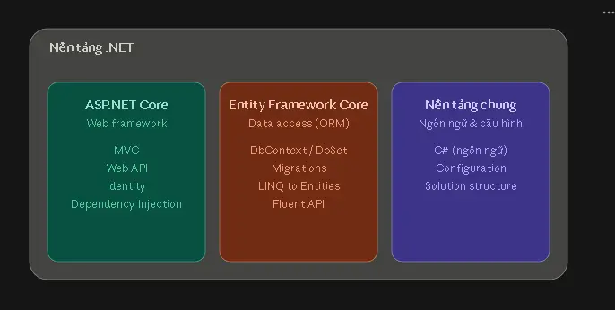

# PBL — Thiết kế hệ thống

Thiết kế phục vụ hệ thống web trung gian cho thuê ô tô. Quy tắc nghiệp vụ thống nhất tại [quy tắc thuê xe](../requirements/shared-rental-rules.md); tài liệu này mô tả cách tổ chức chức năng và dữ liệu.

## 1. Các nhóm chức năng

| Nhóm                    | Nội dung                                                                                                                          |
| ----------------------- | --------------------------------------------------------------------------------------------------------------------------------- |
| Tài khoản               | Đăng ký, đăng nhập, đăng xuất, xem và cập nhật thông tin cá nhân, đổi mật khẩu, vai trò và quyền truy cập                         |
| Đăng ký chủ xe          | Người dùng nộp ảnh CCCD và tối thiểu một xe có giấy đăng ký, bảo hiểm; nhân viên xét duyệt và bổ sung quyền chủ xe khi chấp thuận |
| Tin đăng                | Thêm, xem, sửa, kiểm duyệt và ngừng hiển thị xe; giấy tờ, giá, điểm nhận xe và lịch trống                                         |
| Đơn thuê                | Giữ thông tin giá/cọc, kiểm tra khả dụng nguyên tử khi cọc, tạo `Pending` khóa lịch, chấp thuận, từ chối, hủy và hết hạn           |
| Bàn giao                | Xác nhận và thời điểm riêng của hai bên khi giao và trả xe; không bắt buộc ảnh                                                    |
| Thanh toán và doanh thu | Mô phỏng cọc 25%, hoàn cọc, khoản phạt 40%, trả tiền cho chủ xe và doanh thu khi hoàn tất                                         |
| Quản trị                | Quản lý người dùng và tin đăng; quản trị viên quản lý cấu hình và tài khoản Staff/Admin                                           |
| Phần mở rộng            | Đánh giá, khiếu nại, bản đồ, chatbot, thông báo và báo cáo nâng cao                                                               |

## 2. 3-Layer 

**Presentation Layer** (`CarRental.Web`) nhận yêu cầu, hiển thị dữ liệu và kiểm tra quyền truy cập chức năng. **Business Logic Layer** (`CarRental.Services`) kiểm tra quyền sở hữu, trạng thái đơn, lịch trùng và điều kiện chuyển trạng thái. **Data Layer** (`CarRental.Data`) đọc, ghi MySQL qua Entity Framework Core. `CarRental.Models` chứa các class và data type trao đổi.

## 3. Dữ liệu chính

Đây là danh sách phục vụ thiết kế sơ đồ dữ liệu; tên cột chi tiết được thống nhất khi triển khai.

| Nhóm dữ liệu        | Nội dung cần lưu                                                                                                              |
| ------------------- | ----------------------------------------------------------------------------------------------------------------------------- |
| Tài khoản và quyền  | Các bảng Identity, họ tên, giới tính, email, số điện thoại và quyền truy cập; một người dùng có thể có cả `Renter` và `Owner` |
| GPLX người thuê     | Số GPLX, hạng, ngày hết hạn, ảnh và thời điểm cung cấp trong hồ sơ người dùng                                                 |
| Hồ sơ chủ xe        | Người đăng ký, ảnh CCCD, xe đầu tiên, giấy tờ, kết quả xét duyệt, lý do từ chối và người xử lý                                |
| Xe và tin đăng      | Chủ xe, biển số duy nhất, giấy đăng ký, bảo hiểm và ngày hết hạn, thông tin xe, ảnh, giá, trạng thái tin và tọa độ nhận xe    |
| Lịch xe             | Khoảng chủ xe không nhận thuê và các booking `Pending`, `Accepted`, `Ongoing` cùng xe; hold chưa cọc không giữ lịch           |
| Yêu cầu thuê        | Xe, người thuê, thời gian, giá được xác nhận, trạng thái, thời điểm cọc thành công và hạn phản hồi                            |
| Thanh toán          | Cọc, hoàn cọc, chuyển cọc, khoản phạt, tài khoản và giao dịch của hệ thống ngân hàng giả lập; tiền còn lại chỉ là giá trị hiển thị |
| Bàn giao            | Yêu cầu thuê, thời điểm xác nhận giao và trả xe riêng của mỗi bên                                                             |
| Đánh giá và báo cáo | Yêu cầu thuê, người gửi, người nhận, số sao, nội dung, thời điểm công khai và báo cáo vi phạm                                 |
| Khiếu nại           | Đơn, người gửi, mô tả bắt buộc, ảnh tùy chọn, trạng thái, người xử lý và kết quả `None`/`CancelOwnerFault`/`ForceComplete`    |
| Xử lý vi phạm       | Lịch sử khóa tài khoản, tạm dừng quyền chủ xe, lý do, thời hạn và người thực hiện; xử lý tin đăng được lưu riêng              |

ERD chi tiết và mã DBML được lưu tại [ERD](erd.md).

Hoa hồng mặc định là 5% và dùng một giá trị cấu hình do quản trị viên quản lý trong `[0; 0,25]`. Thay đổi có hiệu lực ngay, không lập lịch áp dụng trong tương lai. Các khoản tạm giữ, hoàn, chuyển cho chủ xe và phạt chạy trong hệ thống ngân hàng giả lập bằng các tài khoản và giao dịch giả; tài khoản không lưu giá trị tiền hoặc hỗ trợ bổ sung tiền, không kết nối ngân hàng thật hoặc xây cơ chế thu nợ.

Thông tin GPLX lưu ở bảng gắn với tài khoản nhưng thuộc hồ sơ người dùng; điều kiện đặt thuê dựa trên số, hạng, ảnh đã lưu và ngày hết hạn. Lịch sử khóa tài khoản được lưu trong `account_sanction` thay vì một cột trạng thái khóa trên tài khoản. Khóa tạo sanction mới; mở khóa ghi `lifted_at`, `lifted_by`, không xóa lịch sử; mỗi tài khoản chỉ có một sanction còn hiệu lực. Trạng thái tạm dừng quyền chủ xe được lưu riêng với khóa tài khoản để không tự khóa quyền `Renter` của cùng người dùng.

## 4. Tạo đơn và giữ lịch

Người thuê phải đã cung cấp số, hạng, ngày hết hạn còn hiệu lực và ảnh GPLX trước khi tạo yêu cầu; việc xem và tìm kiếm xe không phụ thuộc điều kiện này. Hệ thống không xác minh GPLX với nguồn bên ngoài.

Giá thuê tính theo ngày với công thức `số ngày = max(1, ceil((endDate - startDate) / 24 giờ))`; bất kỳ khoảng thuê dương nào ngắn hơn một ngày vẫn tính một ngày. Tổng tiền được khóa bằng số ngày nhân giá/ngày.

Hệ thống lưu xe, khoảng thuê, tổng giá và số tiền cọc 25% trong `DepositHold` ở trạng thái `AwaitingDeposit`. Hold không khóa lịch, không có thời hạn tự hết hiệu lực và nhiều hold giao nhau có thể cùng tồn tại. Hold chuyển `Cancelled` khi người thuê chủ động bỏ hoặc không còn hợp lệ lúc cọc. Cọc thành công tạo booking `Pending`, bắt đầu hạn phản hồi 1 ngày (24 giờ) và khóa lịch ngay; hết hạn phản hồi thì booking chuyển `Expired`, hoàn cọc và giải phóng lịch.

Khi người thuê xác nhận cọc, `BookingService` bắt đầu transaction, khóa hold và dữ liệu theo xe. Service kiểm tra hold thuộc `Renter` hiện tại và đang `AwaitingDeposit`; `start_date` còn ở tương lai; tin `Public`; xe `Approved`; bảo hiểm còn hạn; `Owner` còn `Active`; giá tin không đổi so với hold; GPLX còn hiệu lực đến hết `end_date`; `Renter` không có `account_sanction` còn hiệu lực; xe không giao với `vehicle_unavailability` hoặc booking `Pending`, `Accepted`, `Ongoing`. Nếu hợp lệ, `PaymentService` mô phỏng giao dịch mà không kiểm tra khả năng chi trả; Service lấy số tiền từ hold phía máy chủ để tạo booking `Pending` và payment, chuyển hold sang `Converted`, giữ liên kết `source_hold_id`, rồi commit. Điều kiện không hợp lệ, xung đột lịch, giao dịch mô phỏng thất bại hoặc lỗi xử lý đều rollback và chuyển hold sang `Cancelled`; xung đột lịch trả `409`. Hai hold giao nhau được tuần tự hóa theo xe nên chỉ một hold có thể tạo booking khóa lịch.

Chủ xe chỉ chấp thuận hoặc từ chối booking `Pending` hiện tại. Chấp thuận chuyển sang `Accepted` và tiếp tục giữ lịch; từ chối chuyển `Rejected`, hoàn cọc và giải phóng lịch. Quyết định không tác động booking khác. Giá và cọc lấy từ hold nguồn, không lấy amount do client gửi; các lần gửi lại thao tác cọc, chấp thuận và hoàn tiền không được tạo bản ghi trùng.

Hủy, từ chối và tạm dừng quyền chủ xe phải xử lý cọc theo [quy tắc thuê xe](../requirements/shared-rental-rules.md). Sau khi bắt đầu chuyến, các vấn đề được đưa vào khiếu nại thay vì hủy yêu cầu.

### 4.1. Sequence diagram — Đặt xe, giữ thông tin cọc và tạo booking

## 5. Trạng thái và bàn giao

Trạng thái chính đi theo `Pending → Accepted → Ongoing → Completed`; các nhánh từ chối, hết hạn hoặc hủy được lưu riêng. `Pending`, `Accepted`, `Ongoing` khóa lịch; `Rejected`, `Expired`, `Cancelled` không khóa lịch và `Completed` không ảnh hưởng lịch tương lai. Không thiết kế OTP/QR. Không bắt buộc ảnh.

Mỗi bên xác nhận giao và trả xe độc lập. Hệ thống lưu người, thời điểm từng xác nhận; đủ hai xác nhận giao xe mới chuyển `Ongoing`, đủ hai xác nhận trả xe mới chuyển `Completed` mà không phụ thuộc trạng thái khiếu nại. Nếu mới một bên xác nhận, bản ghi đó được giữ cho đến khi bên còn lại xác nhận hoặc booking chuyển sang trạng thái không còn hợp lệ; không có cơ chế hết hạn, xóa hoặc đặt lại xác nhận do thời gian chờ. Nếu thiếu xác nhận hoặc có bất đồng, một bên có thể tạo khiếu nại. `DisputeService` xử lý `None`, `CancelOwnerFault`, `ForceComplete`. `CancelOwnerFault` áp dụng cho dispute `Open`, booking `Accepted`, đã đến `start_date`; khóa dispute, booking, payment rồi hủy booking, hoàn cọc, tạo khoản phạt `Pending` và resolve dispute trong cùng transaction. `ForceComplete` áp dụng cho booking `Ongoing` đã thực tế kết thúc nhưng thiếu xác nhận `Return`; `None` không đổi booking hoặc dòng tiền. Khiếu nại sau `Completed` chỉ dùng `None`. Không có use case, bảng trạng thái hoặc background job no-show riêng.

## 6. Giá và doanh thu

Lưu giá đã xác nhận trong đơn; nếu giá tin thay đổi trước lúc cọc thì hold không còn hợp lệ. Khi booking `Completed`, cùng transaction, hệ thống lấy tỷ lệ hoa hồng hiện tại từ `system_settings`, tính hoa hồng trên tổng giá, chuyển `deposit_amount - commission_amount` từ `PlatformEscrow` cho `Owner`, giữ lại hoa hồng, chuyển trạng thái cọc sang `Transferred` và ghi `revenue_recorded_at`. Khi `Renter` hủy booking `Accepted`, áp dụng cùng công thức, chuyển trạng thái cọc sang `Forfeited`. `PaymentService` dùng mã giao dịch duy nhất để không ghi doanh thu hai lần.

`UC-O-06` tổng hợp các payment có cọc `Transferred` hoặc `Forfeited`; hiển thị tổng tiền thuê, hoa hồng, phần Owner nhận qua hệ thống và phần tiền còn lại do hai bên xử lý ngoài hệ thống để tham khảo. Dòng `Forfeited` được tách riêng. Khi Admin chỉnh tỷ lệ, giá trị mới có hiệu lực ngay và được dùng khi ghi nhận doanh thu; hệ thống không quản lý lịch áp dụng.

Cọc bằng 25% giá trị chuyến. `Owner` tự hủy booking `Accepted` thì hoàn cọc và thanh toán phạt 40% trong cùng transaction; thanh toán phạt thất bại làm booking giữ `Accepted`. Nếu `Owner` không giao xe, `Renter` gửi khiếu nại và `Staff`/`Admin` xử lý bằng `CancelOwnerFault`, tạo khoản phạt `Pending` để Owner thanh toán. Dùng các mã `DEPOSIT-{holdId}`, `REFUND-{bookingId}`, `SETTLE-{bookingId}`, `FORFEIT-{bookingId}`, `PENALTY-{bookingId}`. Tiền được lưu với hai chữ số thập phân; không thêm thuế hoặc chuyển tiền thật.

## 7. Quyền và dữ liệu cá nhân

Nhân viên (Staff) chỉ xem thông tin cần thiết và quản lý tài khoản người thuê, chủ xe, tin đăng qua các chức năng được phép; không sửa trực tiếp thông tin cá nhân. Quản trị viên (Admin) có thêm quyền cấu hình, báo cáo toàn nền tảng và quản lý nhân viên, quản trị viên khác. Mọi thao tác lên tài khoản quản trị phải kiểm tra quyền quản trị viên thực sự; chỉ có vai trò Identity `Admin` là chưa đủ. Hệ thống không cho tạm dừng hoặc thu hồi quyền của Admin hoạt động cuối cùng có `CanManageAdminAccounts`.

Gỡ tin vi phạm chuyển `vehicle_listings.moderation_status` sang `Hidden`, chặn hold mới, giữ listing, ảnh, lịch sử và booking đã tạo. Tin muốn hiển thị lại phải được Owner sửa và Staff/Admin duyệt lại.

Nhân viên xét duyệt thủ công hồ sơ chủ xe và tin xe rồi chấp thuận hoặc từ chối kèm lý do. Trong phạm vi học tập, hệ thống chỉ yêu cầu các trường và ảnh cần thiết; không xây bộ tiêu chí thẩm định CCCD, GPLX, đăng ký xe hoặc bảo hiểm và không xác minh giấy tờ với nguồn bên ngoài.

Mật khẩu dùng cơ chế băm một chiều của Identity, không thể khôi phục từ hash. Số điện thoại được chuẩn hóa, lưu trong một trường duy nhất có ràng buộc unique và không mã hóa ở cấp trường dữ liệu trong phiên bản v1. Người dùng xem và sửa hồ sơ của mình; chỉ `Staff`/`Admin` xem thông tin cá nhân của người khác theo nhiệm vụ. Không công khai hoặc ghi đầy đủ số điện thoại vào log; không công khai giấy tờ, tài khoản ngân hàng giả lập hoặc ảnh khiếu nại. Chức năng xóa tài khoản nằm ngoài phạm vi v1.

## 8. Tích hợp mở rộng

**Bản đồ:** Leaflet.js và OpenStreetMap hiển thị điểm nhận xe từ `Latitude` và `Longitude`. Dịch vụ đổi địa chỉ thành tọa độ chưa được chọn.

**Chatbot:** tái sử dụng dịch vụ Python với LlamaIndex, Gemini và FastAPI từ [ChatbotRAG](https://github.com/shen1705/Chatbot/tree/An). Ứng dụng .NET gọi dịch vụ qua HTTP. Chatbot chỉ tra cứu chính sách tĩnh; luồng đặt thuê vẫn hoạt động khi chatbot gián đoạn.

